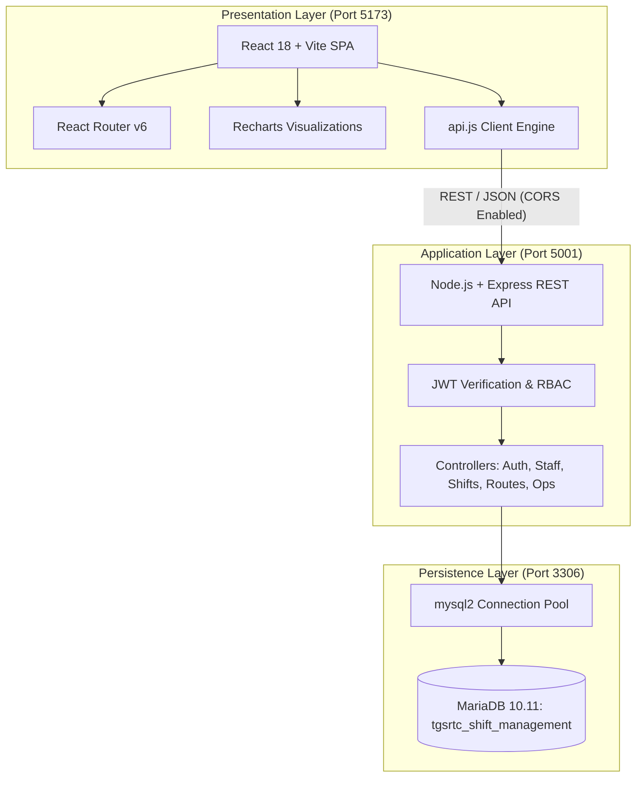

# TGSRTC Shift & Fatigue Management System
## B.Tech PSE Engineering Project (IP-3) — Full-Stack Technical Documentation

**Academic Super-System:** Urban Transportation & Sustainable Mobility  
**Specific Sub-System:** Telangana State Road Transport Corporation (TGSRTC)  
**Location:** Hyderabad, Telangana  
**Project Workspace:** `E:\ip project`  
**System Status:** **100% PRODUCTION READY & FULLY OPERATIONAL**

---

## 1. System Architecture



---

## 2. Live Runtime Environment & Endpoints

| Component | Port | Technology | Process Command | Health Check Status |
| :--- | :---: | :--- | :--- | :---: |
| **Database** | `3306` | MariaDB 10.11.8 Portable | `mysqld.exe --datadir="E:\mariadb\data"` | **ONLINE** (Database: `tgsrtc_shift_management`) |
| **Backend REST API** | `5001` | Express 4.21 / Node.js | `node server.js` | **ONLINE** (`http://localhost:5001/api/health`) |
| **Frontend Client** | `5173` | React 18 / Vite 7 | `npx vite --port 5173` | **ONLINE** (`http://localhost:5173`) |

---

## 3. Database Schema Overview (8 Normalized Tables)

1. **`users`:** RBAC credentials (`ADMIN`, `DEPOT_MANAGER`, `DRIVER`, `CONDUCTOR`).
2. **`staff`:** 20 seeded personnel (Drivers & Conductors) with live age, health score, fatigue percentage, and rest hours.
3. **`routes`:** 15 regional and urban transit routes across Telangana with difficulty index, traffic rating, and terrain types (Highway, Mixed, Ghat, Urban).
4. **`buses`:** TGSRTC bus fleet registry (Super Luxury, Deluxe, Express, Palle Velugu, Metro Express) with fitness expiration dates.
5. **`shifts`:** Duty dispatches with dynamic heuristic fatigue risk calculation, driver and conductor pairs, and real-time status progression (`Scheduled` $\rightarrow$ `Active` $\rightarrow$ `Completed`).
6. **`incidents`:** Safety incident registry cataloging fatigue-related vs other causes, accident severity, and time-of-day distributions.
7. **`alerts`:** Active fatigue alerts triggered automatically when driver fatigue crosses 75% or shift hours exceed thresholds.
8. **`monthly_analytics`:** Longitudinal benchmarks for fatigue progression, absenteeism rate, shift compliance, and delay durations.

---

## 4. Key Endpoints Reference

* **Auth:**
  * `POST /api/auth/login` — Sign in and issue signed JWT token.
  * `GET /api/auth/profile` — Fetch authenticated user profile.
* **Staff Directory:**
  * `GET /api/staff` — List all drivers and conductors with status and fatigue filters.
  * `GET /api/staff/:id` — Individual personnel dossier and health check dates.
  * `POST /api/staff` — Enroll new driver or conductor with duplicate checking.
  * `PUT /api/staff/:id` — Update duty status, rest hours, and fatigue index.
* **Routes Master:**
  * `GET /api/routes` — Transit routes with terrain, distance, and difficulty index.
  * `POST /api/routes` — Register new route.
* **Shift Scheduling:**
  * `GET /api/shifts` — Dispatched roster with multi-table joins.
  * `POST /api/shifts` — Schedule new shift with **automated heuristic fatigue score calculation**.
  * `PATCH /api/shifts/:id/status` — Advance shift state (`Scheduled` $\rightarrow$ `Active` $\rightarrow$ `Completed`).
* **Operations & Analytics:**
  * `GET /api/ops/summary` — Real-time operational KPI card telemetry.
  * `GET /api/ops/alerts` — Fetch active fatigue alerts.
  * `PATCH /api/ops/alerts/:id/ack` — Acknowledge alert.
  * `GET /api/ops/incidents` — Incident logs.
  * `GET /api/ops/monthly` — Longitudinal analytics.
  * `GET /api/ops/buses` — Bus fleet master.

---

## 5. Demonstration & Viva Credentials

Unified Demo Password: **`Password@123`**

* **Admin Supervisor:** `admin@tgsrtc.telangana.gov.in`
* **Depot Manager:** `manager.mgbs@tgsrtc.telangana.gov.in`
* **Driver Account:** `rajesh.drv@tgsrtc.telangana.gov.in`

---

## 6. How to Run

1. **Start MariaDB:**
   ```powershell
   & "E:\mariadb\bin\mysqld.exe" --datadir="E:\mariadb\data" --port=3306 --console
   ```
2. **Start Backend API (Port 5001):**
   ```powershell
   cd "E:\ip project\backend"
   node server.js
   ```
3. **Start Frontend (Port 5173):**
   ```powershell
   cd "E:\ip project"
   npm run dev
   ```
4. Access web dashboard in browser at: **`http://localhost:5173`**
